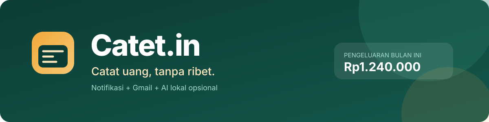

<p align="center">
  
</p>

<p align="center">
  <strong>Pencatat keuangan pribadi untuk Android yang mengubah notifikasi dan email transaksi menjadi catatan yang rapi.</strong>
</p>

<p align="center">
  <a href="LICENSE"></a>
  
  
</p>

Catet.in adalah aplikasi Android lokal-pertama untuk mencatat pemasukan, pengeluaran, transfer, anggaran, dan saldo. Sumber utama otomatisasinya adalah **notifikasi aplikasi bank/e-wallet yang diizinkan pengguna** dan **Gmail dengan akses baca saja**. Tidak ada SMS, iklan, analytics, atau pengiriman data keuangan ke server Catet.in.

Proyek ini dibangun dari [PRD dan rencana implementasi](docs/PRD.md) yang disusun untuk kebutuhan pribadi. Implementasinya ditulis sebagai aplikasi Android baru; bukan fork kode PennyWise.

## Yang sudah tersedia

- **Penangkapan notifikasi dengan allow-list.** Nama paket diperiksa terlebih dahulu; isi notifikasi hanya dibaca setelah paket diizinkan. Tidak ada izin atau pembacaan SMS.
- **Gmail read-only.** OAuth memakai scope tunggal `gmail.readonly`, token disimpan dengan Android Keystore, sinkronisasi bertahap berjalan lewat WorkManager, dan hanya pengirim yang diaktifkan yang diproses aplikasi.
- **Dedupe lintas sumber.** Satu pembayaran yang muncul sebagai notifikasi dan email dihitung sekali. Referensi transaksi menjadi pencocok utama; kecocokan nominal, arah, institusi, merchant, dan waktu menangani kasus tanpa referensi. Kandidat yang ambigu masuk ke antrean tinjauan, bukan digabung diam-diam.
- **Pencatatan yang bisa dikoreksi.** Tambah/edit/hapus transaksi, audit sumber, pencarian, filter, kategori, aturan otomatis, deteksi langganan, anggaran, analitik, dan widget.
- **Review Queue dan Unparsed bucket.** Teks yang belum dipahami tidak dibuang; pengguna dapat membuat transaksi atau aturan dari sumber tersebut.
- **Privasi dan pemulihan data.** Backup/restore JSON, ekspor CSV, retensi teks mentah, app lock biometrik/PIN, dan opsi menyamarkan isi aplikasi di app switcher.
- **Asisten lokal opsional.** Router deterministik menjawab pola umum tanpa model. Qwen3.5-0.8B Q4_0 dapat diunduh setelah persetujuan atau diimpor sebagai GGUF; inferensi berjalan di proses `:ai` yang terpisah dan dilepas saat tidak digunakan.
- **Ramah perangkat terbatas.** Aplikasi inti tetap berfungsi tanpa model AI. Runtime model dibatasi pada `arm64-v8a` dan dirancang untuk perangkat sekitar 4 GB RAM.

## Prinsip data

| Data | Perlakuan |
| --- | --- |
| Notifikasi | Hanya paket pada allow-list yang isinya dibaca. Teks disimpan lokal di database privat aplikasi. |
| Gmail | Hanya header/isi dari query pengirim yang aktif; akses read-only, tanpa kirim, ubah, atau hapus email. |
| Token OAuth | Disimpan terenkripsi AES-GCM dengan kunci Android Keystore; bukan bagian dari backup. |
| Transaksi | Tetap di perangkat. Tidak ada backend Catet.in, telemetry, atau iklan. |
| Model AI | Berjalan lokal; prompt hanya berisi pertanyaan dan intent, bukan seluruh riwayat transaksi. |

Jaringan hanya dipakai untuk OAuth/Gmail dan unduhan model dari domain HTTPS yang ditetapkan. `network_security_config.xml` mematikan cleartext, tetapi bukan firewall; pembatasan endpoint tetap dilakukan oleh kode aplikasi.

## Mulai build

Kebutuhan:

- JDK 21
- Android SDK dengan platform `android-37.0` dan build-tools 37.0.0
- Windows, macOS, atau Linux
- Perangkat/emulator **arm64-v8a** untuk menjalankan fitur AI (kompilasi dapat dilakukan di x86_64)

```bash
git clone https://github.com/Rezhnn/Catet.in.git
cd Catet.in
./gradlew :parser-core:test :app:testDebugUnitTest :app:assembleDebug
```

Di PowerShell Windows:

```powershell
$env:JAVA_HOME = 'C:\Program Files\Eclipse Adoptium\jdk-21.0.13.9-hotspot'
$env:ANDROID_HOME = 'F:\Android\Sdk'
.\gradlew.bat :parser-core:test :app:testDebugUnitTest :app:assembleDebug --console=plain
```

APK debug dihasilkan di `app/build/outputs/apk/debug/`. Build debug memakai `applicationIdSuffix .debug`, sehingga OAuth Android harus memakai paket `com.catetin.app.debug` bila ingin menguji Gmail pada build debug.

## Mengaktifkan Gmail

Client ID tidak di-commit. Buat OAuth client Android di Google Cloud, lalu sediakan nilai berikut saat build:

```properties
# local.properties — jangan commit
GMAIL_OAUTH_CLIENT_ID=1234567890-abcdef.apps.googleusercontent.com
```

Atau gunakan environment variable `GMAIL_OAUTH_CLIENT_ID`. Scope yang diminta aplikasi tetap `https://www.googleapis.com/auth/gmail.readonly`. Ikuti [docs/GMAIL_SETUP.md](docs/GMAIL_SETUP.md) untuk package name, SHA-1, status consent screen, dan troubleshooting.

Tanpa client ID, seluruh fitur ledger tetap berjalan; tombol Gmail akan menampilkan panduan konfigurasi.

## Asisten lokal dan fine-tuning

Model resmi yang dipatok aplikasi:

- Model: [Qwen/Qwen3.5-0.8B](https://huggingface.co/Qwen/Qwen3.5-0.8B) (Apache-2.0)
- GGUF: [ggml-org/Qwen3.5-0.8B-GGUF](https://huggingface.co/ggml-org/Qwen3.5-0.8B-GGUF), `Qwen3.5-0.8B-Q4_0.gguf`
- Ukuran: 563.036.064 byte
- SHA-256: `57d1997790d1744fba5b40a7317df71ea5e2acee28c47e78f0cce39c0703f8cf`

Unduhan memerlukan persetujuan eksplisit, dapat dilanjutkan, dan diverifikasi SHA-256 sebelum dipakai. Kit dataset, QLoRA, evaluasi, dan ekspor GGUF tersedia di [training/](training/README.md). Dataset yang disertakan berisi 6.351 contoh latih dan 1.121 evaluasi sintetis.

**Status jujur:** fine-tuning belum dijalankan pada mesin i5-3470/iGPU ini; kit menolak berjalan tanpa CUDA. Model dasar dapat dipakai tanpa pelatihan, tetapi kompatibilitas runtime Qwen3.5 dengan AAR `llama-android` belum diuji pada perangkat fisik. Hasil fine-tune harus dievaluasi dengan `training/evaluate.py` sebelum angka kualitas diklaim.

Mode berpikir diminta nonaktif pada sistem prompt dan chat template pelatihan. Aplikasi hanya menerima JSON intent dan menghitung semua angka secara deterministik di Kotlin.

## Struktur repository

```text
app/                 aplikasi Android, Room, WorkManager, Gmail, UI Compose, proses :ai
parser-core/         parser transaksi Indonesia murni Kotlin/JVM, tanpa dependensi Android
training/            dataset sintetis, QLoRA, evaluasi, merge adapter, dan panduan GGUF
docs/                arsitektur, setup Gmail, keamanan, rilis, dan batasan AI
.github/workflows/   CI compile/test/APK dan alur rilis manual
scripts/             pembuatan paket rilis lokal
```

Arsitektur dan batas kepercayaan dijelaskan di [docs/ARCHITECTURE.md](docs/ARCHITECTURE.md) dan [docs/SECURITY.md](docs/SECURITY.md).

## Status rilis

Versi `0.1.0` adalah baseline awal. APK yang dipublikasikan dari mesin build ini ditandatangani dengan keystore rilis lokal; detail dan checksum dicantumkan pada halaman GitHub Releases. Sebelum dipakai sebagai satu-satunya catatan keuangan, lakukan uji pada perangkat target dan simpan backup JSON di lokasi aman.

Batasan yang masih perlu diuji di perangkat nyata: alur OAuth Gmail live, perilaku NotificationListener pada OEM (Xiaomi/Oppo/Vivo/Samsung), profil memori 4 GB, dan pemuatan Qwen3.5 melalui `llama.cpp`.

## Lisensi dan atribusi

Kode Catet.in dilisensikan **AGPL-3.0**. Lihat [LICENSE](LICENSE) dan [NOTICE](NOTICE). PennyWise adalah proyek terpisah oleh pemiliknya; Catet.in tidak memakai nama, logo, aset toko, atau kode sumber PennyWise. Qwen dan llama.cpp memiliki lisensi serta pemilik masing-masing.

Kontribusi diterima melalui issue/PR. Baca [CONTRIBUTING.md](CONTRIBUTING.md) sebelum mengirim perubahan parser atau model.
