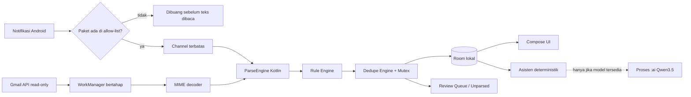

# Arsitektur Catet.in

## Ringkasan

Catet.in memakai satu database Room untuk ledger dan dua jalur ingestion yang bermuara pada pipeline yang sama.

## Modul

| Modul | Tanggung jawab |
| --- | --- |
| `:parser-core` | Normalisasi teks, pembacaan nominal Indonesia/multivaluta, arah transaksi, institusi, merchant, referensi, kategori awal. Tidak bergantung pada Android. |
| `:app` | UI Compose, Room, Hilt, WorkManager, notifikasi, Gmail OAuth/API, dedupe, aturan, backup, widget, app lock. |
| proses `:ai` | Hanya memuat llama.cpp dan menjalankan inferensi model. Tidak memiliki akses Room. |
| `training/` | Dataset intent sintetis, QLoRA, evaluasi, merge adapter, dan ekspor GGUF. |

## Jalur notifikasi

`CatetNotificationListener` menerima `StatusBarNotification` di binder thread dan hanya memasukkan objek tersebut ke channel berkapasitas terbatas. Pemeriksaan nama paket, pembacaan extras, parsing, dan database dilakukan pada `Dispatchers.IO`. Paket di luar allow-list tidak pernah dibaca isinya.

Saat listener pertama kali terhubung, notifikasi aktif diambil sekali. Android tidak menyediakan riwayat notifikasi sebelum listener dipasang; karena itu gap masa lalu harus diisi lewat Gmail atau input manual.

`onListenerDisconnected` meminta rebind setelah jeda singkat bila izin masih ada. Perubahan notifikasi yang diposting ulang dilindungi idempotency `SourceEvent` lalu dedupe transaksi.

## Jalur Gmail

1. AppAuth meminta `gmail.readonly` dengan PKCE dan `access_type=offline`.
2. `AuthState` dienkripsi AES-GCM dengan kunci Android Keystore dan disimpan di SharedPreferences privat.
3. WorkManager berjalan kira-kira setiap jam saat jaringan tersedia.
4. Backfill awal memakai query `after:` dan pengirim aktif, maksimal 100 pesan per putaran. Page token disimpan agar pekerjaan berikutnya melanjutkan halaman yang sama.
5. Setelah backfill selesai, `historyId` menjadi watermark sinkronisasi inkremental.
6. Jika history kedaluwarsa (HTTP 404), aplikasi mengambil profile dan mengulang jendela terbatas.
7. Respons HTTP dibatasi ukurannya; retry hanya untuk 429/5xx/error jaringan. HTTP 401 menandai kebutuhan reconnect.

Tidak ada token atau isi email yang dikirim ke Catet.in. Endpoint keluar yang dipakai aplikasi adalah `gmail.googleapis.com`, `oauth2.googleapis.com`, `accounts.google.com`, dan Hugging Face untuk model.

## Pipeline transaksi

Setiap artefak menjadi `SourceEvent` dengan unique key `(type, externalId)`. `RawArtifact` dinormalisasi dan dijalankan ke parser yang cocok. Hasilnya salah satu:

- `Parsed`: nominal dan arah jelas, lalu melewati aturan pengguna.
- `Ignored`: OTP, login, promosi tanpa pembayaran selesai, atau transaksi gagal/pending.
- `Unparsed`: terlihat finansial tetapi belum dapat dipahami; masuk bucket untuk koreksi pengguna.

Aturan dapat mengubah kategori, merchant, atau memblokir artefak. Transaksi berstatus `NEEDS_REVIEW` bila yakinnya rendah, arahnya transfer, atau dedupe ambigu.

## Dedupe dan konsistensi

Candidate lookup dan insert berada dalam satu `Mutex`, sehingga notification listener dan Gmail worker tidak dapat sama-sama melihat ledger kosong lalu menyisipkan transaksi duplikat.

Urutan pencocokan:

1. Referensi transaksi yang ternormalisasi; lebih dari satu kandidat berarti ambigu.
2. Nominal + mata uang + arah + institusi + merchant, dengan jendela 72 jam untuk lintas sumber dan 15 menit untuk sumber yang sama.
3. Nominal + institusi + waktu dekat; jendela 30 menit lintas sumber atau 10 menit dalam sumber yang sama. Merchant yang sama-sama diketahui harus kompatibel.
4. Bila beberapa kandidat cocok, transaksi baru masuk Review Queue dengan kandidat pertama; pengguna memilih merge atau keep separate.

Merchant dinormalisasi terhadap kapitalisasi, tanda baca, dan frasa umum seperti “Pembayaran ke”. Referensi hanya dibandingkan setelah karakter non-alfanumerik dibuang. Perbandingan jenis transaksi (keluar/masuk/transfer) tidak pernah dilonggarkan.

## Proses AI

Asisten memakai dua tingkat:

- **Fast path deterministik** untuk pertanyaan umum seperti total pengeluaran bulan ini, pemasukan, saldo, jumlah transaksi, dan rincian kategori. Ini tetap berjalan tanpa model.
- **Qwen3.5-0.8B** hanya mengubah pertanyaan bebas menjadi JSON intent tervalidasi. Angka dihitung kode Kotlin dari Room; model tidak menerima ledger mentah dan tidak diminta mengarang jawaban.

Service model berada di `android:process=":ai"`. Coordinator memuatnya saat tab Asisten terlihat, memberi grace period 15 detik, lalu melepasnya saat tab ditinggalkan, app masuk background, atau memori tertekan. Model yang gagal dimuat tidak menghentikan proses utama atau NotificationListener.

## Batas yang diketahui

- Room belum dienkripsi dengan SQLCipher; perlindungan utama adalah sandbox OS, app lock, dan backup Android yang dimatikan.
- `network-security-config` menolak cleartext tetapi bukan firewall outbound.
- Pengujian perangkat fisik (Gmail OAuth, OEM background policy, memori Qwen) belum lengkap dalam baseline ini.
